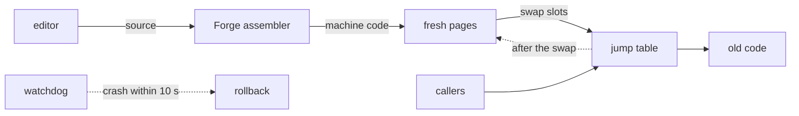

<p align="center">
  
</p>

<h1 align="center">Vitre OS</h1>

<p align="center">
  <b>A 64-bit operating system in pure x86-64 assembly that can rewrite itself while it runs.</b><br>
  It has a desktop, a mouse, TLS 1.3 and a web browser, and not one line of C.
</p>

<p align="center">
  
  
  
  
</p>

<p align="center">
  <a href="https://github.com/rezk2ll/vitre-os/actions/workflows/ci.yml"></a>
  
  <a href="LICENSE"></a>
  
  
  
  
  
  <br>
  
  
  
  
  
  <br>
  
  
  
  
  
</p>

<p align="center">
  <a href="#try-it">Try it</a> ·
  <a href="#tour">Tour</a> ·
  <a href="#how-a-live-patch-works">Live patching</a> ·
  <a href="#whats-inside">What's inside</a> ·
  <a href="#docs">Docs</a>
</p>

<p align="center">
  
</p>

## Try it

You need `nasm` 2.16, `qemu-system-x86_64`, `make` and Python 3.

```sh
git clone https://github.com/rezk2ll/vitre-os
cd vitre-os
make run
```

It boots to the desktop. Click once in the QEMU window to give it the mouse (Ctrl+Alt+G takes it back), then click a tile or press its number. `make run CMDLINE=` boots straight to the shell.

The keyboard starts in AZERTY. Type `layout qwerty` in the shell to switch.

## Tour

### Patch the kernel without a reboot

The image carries its own source. Open a kernel function in the editor, change it, and `patch` assembles it in the kernel and swaps it in. Here `kput_dec` learns to print digits as letters, so `mem` reports `pages free DCABC`, until `rollback` puts the old code back.

<p align="center"></p>

### Watch any task from the inside

Glass shows a task's registers, the disassembly around RIP, its stack with symbols and its memory, all updating live. `p` pauses the task, `s` steps one instruction, `f` opens the module it is running in the editor.

<p align="center"></p>

### Get online

DHCP at boot, then DNS, ICMP, TCP, HTTP and a TLS 1.3 client, all written in assembly.

<p align="center"></p>

A few commands to try in the shell:

- `help` lists every command
- `browse https://www.wikipedia.org/` opens the browser; click a link or type its number
- `edit kernel/report.asm`, then `patch kernel/report.asm` and `rollback`
- `glass` watches the newest task, or starts a demo one
- `desktop` goes back to the desktop, `shutdown` powers off

Up and Down bring back earlier commands and Tab completes a command name. PgUp, PgDn and the mouse wheel scroll back through earlier output.

## How a live patch works

Patchable functions are called through a jump table. A patch never touches running code: it is assembled into fresh pages and the table slots are swapped.



- Forge is an in-kernel assembler that produces the same bytes as NASM for the [dialect](docs/DIALECT.md) the kernel is written in.
- A crash in new code within 10 seconds rolls the patch back on its own.
- `save` writes the patch to disk, and it is applied again at the next boot.

## What's inside

- Boot: a 512-byte MBR, then a stage 2 that reads the E820 map, sets a 1024x768 VBE mode and enters long mode.
- Kernel: interrupts, PIT timer, a bitmap page allocator, a first-fit heap and a preemptive round-robin scheduler.
- Drivers: serial, PS/2 keyboard (AZERTY and QWERTY) and mouse, VBE framebuffer, RTC, ATA PIO, PCI and an Intel e1000 network card.
- Network: Ethernet, ARP, IPv4, ICMP, UDP, DHCP, DNS, TCP and HTTP with redirects.
- Crypto: SHA-256, HMAC, HKDF, ChaCha20-Poly1305, X25519, P-256 ECDSA and X.509 parsing, behind a TLS 1.3 client.
- Apps: the desktop, a shell, a disassembler, the Glass views, the editor and a browser with headings, links, scrolling and history.

`make test` boots the image headless in QEMU and drives it over serial, QMP and screen dumps: 68 tests, run on every push.

## Limits

- QEMU with legacy BIOS boot is the only target. Real hardware is untested.
- Certificate chain checks are partial, and the browser's title bar says when a page is unverified.
- One TCP connection at a time, and no user mode: everything runs in ring 0.

## Repo layout

- `boot`: stage 1 and stage 2
- `kernel`: memory, interrupts, scheduler, symbols
- `drivers`: serial, timer, keyboard, mouse, framebuffer, disk, PCI, e1000
- `net`: the network stack, TLS and X.509
- `lib`: strings and crypto primitives
- `forge`: the assembler, the editor and the patcher
- `glass`: the font, console, pointer, disassembler and debugger views
- `apps`: the desktop, the shell, the browser and the crypto command
- `tests`: the Python harness that drives QEMU

## Docs

- [ARCHITECTURE.md](docs/ARCHITECTURE.md): memory map, boot flow and how the parts fit
- [STATUS.md](docs/STATUS.md): milestones and what each one delivered
- [DECISIONS.md](docs/DECISIONS.md): every non-obvious choice and why
- [ABI.md](docs/ABI.md): calling convention and function headers
- [DIALECT.md](docs/DIALECT.md): the NASM subset Forge assembles
- [BRIEF.md](docs/BRIEF.md): the original spec

## Why "Vitre"

Vitre is French for a pane of glass. The idea is that you can see through the system: any task can be paused and read, and the kernel's own source is one command away.

## License

[MIT](LICENSE)
