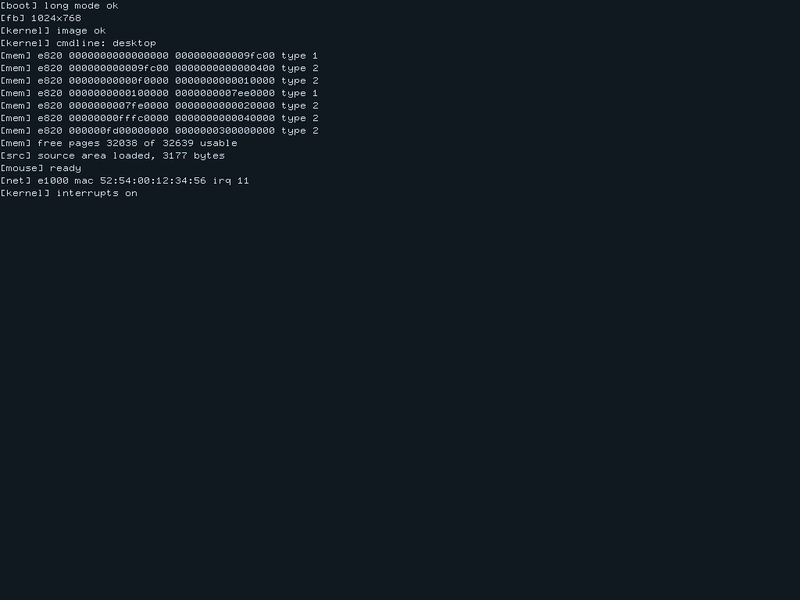
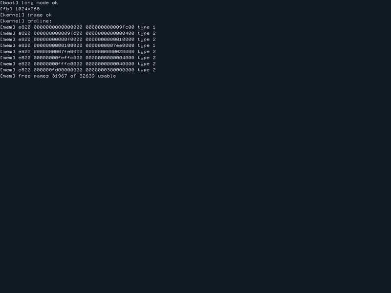
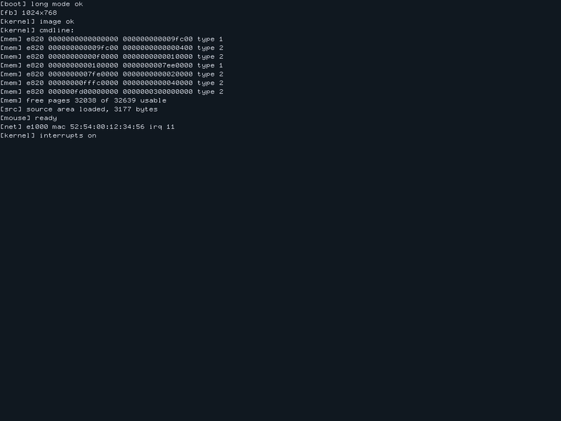

<p align="center">
  
</p>

<h1 align="center">Vitre OS</h1>

<p align="center">
  <b>A 64-bit operating system in pure x86-64 assembly that can rewrite itself while it runs.</b><br>
  It has a desktop, a mouse, sound, a video player, TLS 1.3 and a web browser, and not one line of C.
</p>

<p align="center">
  <a href="https://github.com/rezk2ll/vitre-os/actions/workflows/ci.yml"></a>
  <a href="LICENSE"></a>
  
  
  
  
  
</p>

<p align="center">
  <a href="#try-it">Try it</a> ·
  <a href="#tour">Tour</a> ·
  <a href="#shell">Shell</a> ·
  <a href="#docs">Docs</a>
</p>

<p align="center">
  
</p>

## Try it

You need `nasm` 2.16, `qemu-system-x86_64`, `make` and Python 3.

```sh
git clone https://github.com/rezk2ll/vitre-os
cd vitre-os
make run
```

It boots to the desktop. Click once in the QEMU window to give it the mouse (Ctrl+Alt+G takes it back), then click an icon: apps start, programs run and other files open in the editor. A right click opens a menu to make a new file, or to open, edit or delete one.

The keyboard starts in AZERTY. Type `layout qwerty` in the shell to switch.

## Tour

### Patch the kernel without a reboot

The image carries its own source. Open a kernel function in the editor, change it, and `patch` assembles it in the kernel and swaps it in. Here `kput_dec` learns to print digits as letters, so `mem` reports `pages free DCABC`, until `rollback` puts the old code back. A crash in the new code within 10 seconds rolls it back on its own. [How it works](docs/ARCHITECTURE.md#live-patching).

<p align="center"></p>

### Watch any task from the inside

Glass shows a task's registers, the disassembly around RIP, its stack with symbols and its memory, all updating live. `p` pauses the task, `s` steps one instruction, `f` opens the module it is running in the editor.

<p align="center"></p>

### Ask any pixel who drew it

Every pixel on screen remembers the call chain that drew it. Press F12 in any app to freeze the screen, then click: everything else dims and the functions behind that pixel appear beside the pointer. `why <x> <y>` prints the same chain in the shell.

<p align="center"></p>

### Write a program and run it

Programs are assembly files on the disk. Write one in the editor and `run` it: Vitre assembles it with its own assembler and calls it. A program can call any kernel function by name, and if it crashes, only the program stops. The disk comes with a few: `hello.asm`, `guess.asm`, `snake.asm`, `cube.asm`, a shaded cube that turns, and `song.asm`, a tune written as notes.

<p align="center"></p>

### Draw and listen

Paint opens from the desktop or with `paint`. The left button draws in the colour picked from the top bar, the right one rubs out, and `[` and `]` change the brush. Sound goes through an AC97 card, which `make run` adds: `beep 880` plays a tone and `run song.asm` plays a tune.

### Watch a video

`samples/demo.viv` is a 15 second clip with a tune: bouncing balls, and bars that jump with the melody. Serve the folder, then click the Video icon and type `http://10.0.2.2:8000/demo.viv`:

```sh
caddy file-server --root samples --listen :8000
```

10.0.2.2 is the host as QEMU's network sees it. The server has to answer range requests: Python 3.12's `http.server` ignores them, and then only the first chunk plays. q stops the video.

#### Make your own

`.viv` is Vitre's own format: 256 colours, only the pixels that changed, 16 kHz sound, cut in chunks it streams with HTTP range requests. `build/vivenc`, also assembly, makes one from raw frames and raw sound, so any video ffmpeg reads will do:

```sh
make build/vivenc
yt-dlp -f mp4 -o clip.mp4 <url>
ffmpeg -i clip.mp4 -f u8 -ac 1 -ar 16000 clip.u8
ffmpeg -i clip.mp4 -vf scale=320:180,fps=15 -f rawvideo -pix_fmt rgb24 - \
  | build/vivenc 320 180 15 3< clip.u8 > clip.viv
```

Leave out `3< clip.u8` for a silent video.

### Get online

DHCP at boot, then DNS, ICMP, TCP, HTTP and a TLS 1.3 client, all written in assembly. `browse https://www.wikipedia.org/` opens the browser: click a link or type its number.

<p align="center"></p>

## Shell

The Terminal icon opens it, and `make run CMDLINE=` boots straight to it.

- `help` lists every command
- `edit kernel/report.asm`, then `patch kernel/report.asm` and `rollback`
- `glass` watches the newest task, or starts a demo one
- `ls`, then `run hello.asm`; `save` keeps your files across reboots
- `play <url>` streams a video, `beep [hz]` plays a tone
- `desktop` goes back to the desktop, `shutdown` powers off

Up and Down bring back earlier commands and Tab completes a command name. PgUp, PgDn and the mouse wheel scroll back through earlier output.

## Limits

- QEMU with legacy BIOS boot is the only target. Real hardware is untested.
- Certificate chain checks are partial, and the browser's title bar says when a page is unverified.
- One TCP connection at a time, and no user mode: everything runs in ring 0.

## Docs

- [ARCHITECTURE.md](docs/ARCHITECTURE.md): what is inside, the repo layout, memory map, boot flow and how the parts fit
- [DECISIONS.md](docs/DECISIONS.md): every non-obvious choice and why
- [ABI.md](docs/ABI.md): calling convention and function headers
- [DIALECT.md](docs/DIALECT.md): the NASM subset Forge assembles

## Why "Vitre"

Vitre is French for a pane of glass. The idea is that you can see through the system: any task can be paused and read, and the kernel's own source is one command away.

## License

[MIT](LICENSE)
