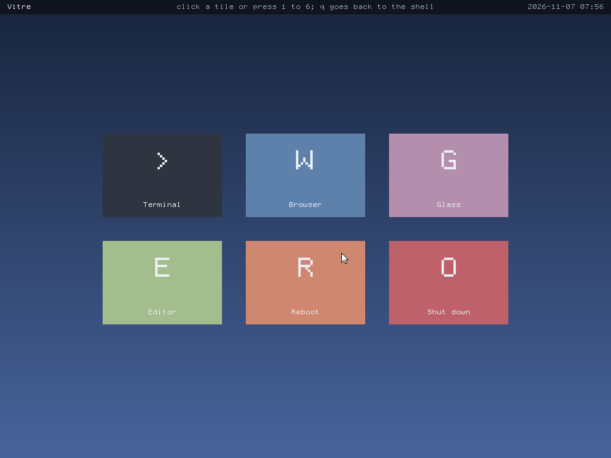
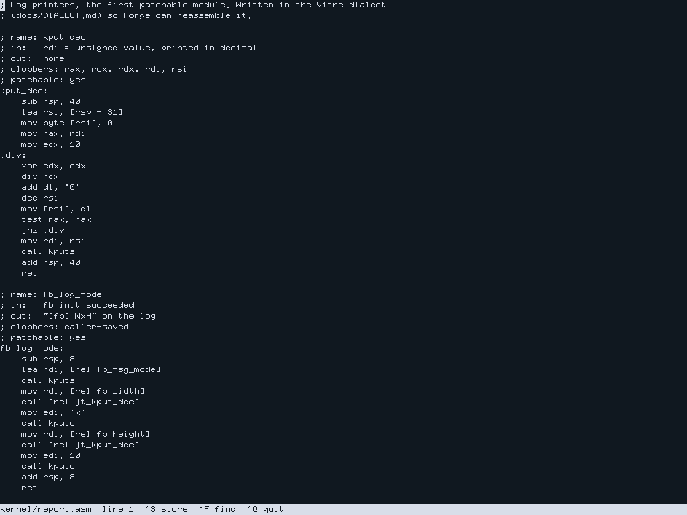
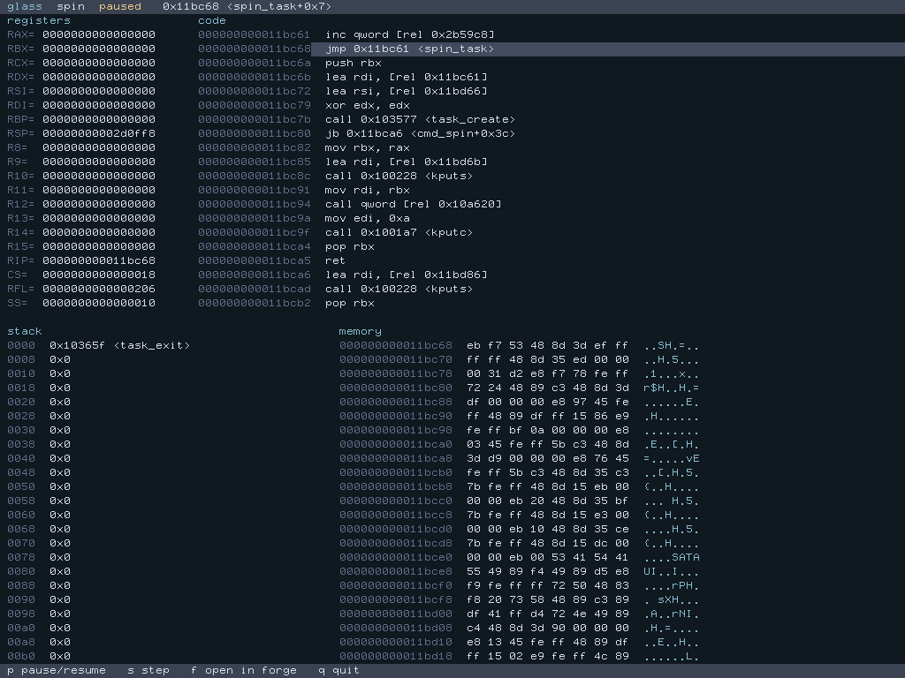
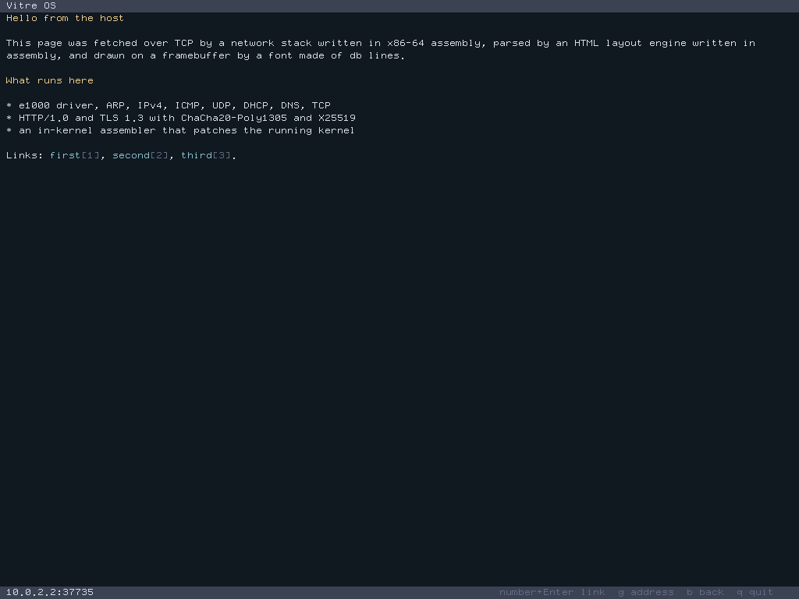

# Vitre OS

[](https://github.com/rezk2ll/vitre-os/actions/workflows/ci.yml)

A 64-bit operating system written entirely in x86-64 assembly. It carries its own source code, so you can edit a kernel function from inside the running system, assemble it and swap it in live. It also gets online: DHCP, DNS, TCP, a TLS 1.3 client and a small web browser, all in assembly.



## Try it

You need `nasm` 2.16, `qemu-system-x86_64`, `make` and Python 3.

```sh
git clone https://github.com/rezk2ll/vitre-os
cd vitre-os
make run
```

It boots to the desktop: click a tile (click once in the QEMU window to give it the mouse, Ctrl+Alt+G to take it back), or press its number. Terminal, or `q`, opens the shell; `desktop` comes back to it, `shutdown` powers off. `make run CMDLINE=` boots straight to the shell.

The keyboard starts in AZERTY. Type `layout qwerty` to switch. In the shell, try:

- `help` lists every command
- `glass` starts a demo task and watches it live; `p` pauses it, `s` steps it
- `edit kernel/report.asm` opens the editor on kernel source; `patch kernel/report.asm` runs your edit without a reboot
- `browse https://www.wikipedia.org/` opens the browser
- `ping 10.0.2.2`, `host wikipedia.org`, `get http://example.org/`

`make test` boots the image headless in QEMU and runs the test suite against the serial log and the screen.

## Ideas

Vitre ("glass" in French) is built around two ideas.

- Self-rewriting. The kernel image ships with the source of its patchable modules, an editor and Forge, an in-kernel assembler that produces the same bytes as NASM. Patchable functions are called through a jump table, so a patch is assembled into fresh pages and the table slots are swapped. A crash in new code within 10 seconds rolls the patch back, and `save` keeps it across reboots.
- The debugger is the UI. Glass shows a task's registers, disassembly around RIP, stack with symbols and memory, updating live. Any task can be paused, single-stepped, given a breakpoint, or opened in the editor on the module it is running.





## What's inside

About 18,600 lines of assembly, a 120 KiB kernel.

- Boot: a 512-byte MBR, then a stage 2 that reads the E820 map, sets a 1024x768 VBE mode and enters long mode.
- Kernel: interrupts, PIT timer, a bitmap page allocator, a first-fit heap and a preemptive round-robin scheduler.
- Drivers: serial, PS/2 keyboard (AZERTY and QWERTY), VBE framebuffer, ATA PIO, PCI and an Intel e1000 network card.
- Network: Ethernet, ARP, IPv4, ICMP, UDP, DHCP, DNS, TCP and HTTP/1.0.
- Crypto: SHA-256, HMAC, HKDF, ChaCha20-Poly1305, X25519, P-256 ECDSA and X.509 parsing, behind a TLS 1.3 client.
- Apps: a shell, a disassembler, the Glass views, the editor and a browser with headings, links, scrolling and history.



## Limits

- QEMU with legacy BIOS boot is the only target. Real hardware is untested.
- HTTPS works, but the server's certificate chain is not verified yet, and the browser says so in its title bar. Chain checks are the current milestone.
- One TCP connection at a time, and no user mode: everything runs in ring 0.

## Repo layout

- `boot`: stage 1 and stage 2
- `kernel`: memory, interrupts, scheduler, symbols
- `drivers`: serial, timer, keyboard, framebuffer, disk, PCI, e1000
- `net`: the network stack, TLS and X.509
- `lib`: strings and crypto primitives
- `forge`: the assembler, the editor and the patcher
- `glass`: the font, console, disassembler and debugger views
- `apps`: the shell, the browser and the crypto command
- `tests`: the Python harness that drives QEMU, one file per milestone

## Docs

- [ARCHITECTURE.md](docs/ARCHITECTURE.md): memory map, boot flow and how the parts fit
- [STATUS.md](docs/STATUS.md): milestones and what each one delivered
- [DECISIONS.md](docs/DECISIONS.md): every non-obvious choice and why
- [ABI.md](docs/ABI.md): calling convention and function headers
- [DIALECT.md](docs/DIALECT.md): the NASM subset Forge assembles
- [BRIEF.md](docs/BRIEF.md): the original spec

## License

[MIT](LICENSE)
