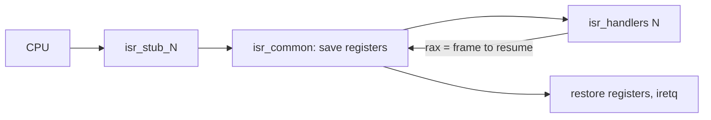
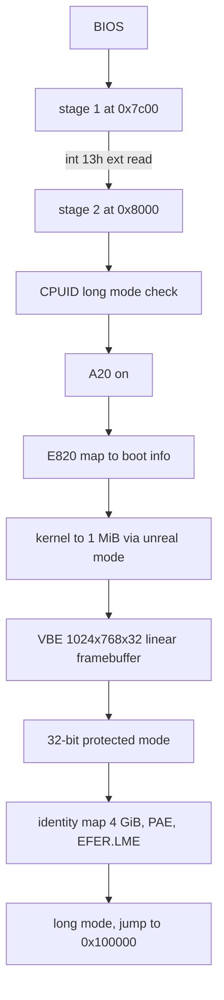
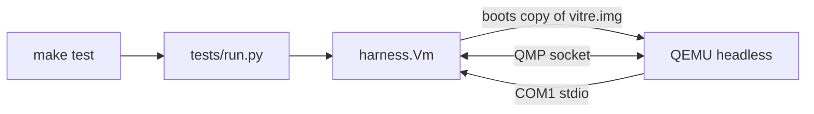

# Architecture

## Disk image

- LBA 0: stage 1 (MBR)
- LBA 1 to 32: stage 2
- LBA 64 onward: kernel

## Physical memory

- 0x5000: boot info (E820 count, framebuffer address, pitch, size and depth, E820 entries at 0x5100)
- 0x6000: VBE controller and mode info buffers (stage 2 only)
- 0x7c00: stage 1, real-mode stack below it
- 0x8000: stage 2
- 0x20000: kernel load bounce buffer (32 KiB)
- 0x70000: page tables (PML4, PDPT, 4 page directories)
- 0x90000: initial kernel stack top
- 0x100000: kernel image, then its .bss (cleared at entry)

## Interrupts

Every vector has a stub that pushes an error code (a zero when the CPU pushes none) and the vector number, then jumps to `isr_common`. `isr_common` saves all general registers and calls the handler registered for the vector with `rdi` = frame. The handler returns in `rax` the frame to resume, so a handler can switch to another task by returning that task's saved frame.

Frame layout, from the lowest address: r15, r14, r13, r12, r11, r10, r9, r8, rbp, rdi, rsi, rdx, rcx, rbx, rax, vector, error, then the CPU part (rip, cs, rflags, rsp, ss). Offsets are the `INT_FRAME_*` constants in `kernel/idt.asm`.

- Vectors 0 to 31: CPU exceptions. Without a registered handler, `exception_fatal` dumps the frame and halts.
- Vectors 32 to 47: PIC IRQ 0 to 15. IRQ 0 is the PIT at 1000 Hz, counting `timer_ticks`.

## Boot flow

## Test flow

## Screen

- `drivers/fb.asm`: framebuffer primitives (fill, glyph, scroll a rectangle), 32 bpp `0x00RRGGBB`.
- `glass/console.asm`: a console is a struct (origin, size in cells, cursor, colours) drawing on the 8x16 grid. The kernel log owns a full-screen one; Glass panes will each own one.
- `kputc` writes every byte to COM1 and, once the framebuffer is up, to the kernel console.
- `drivers/keyboard.asm`: IRQ 1 decodes scancodes into key codes in a ring buffer read by `kbd_getc`.
