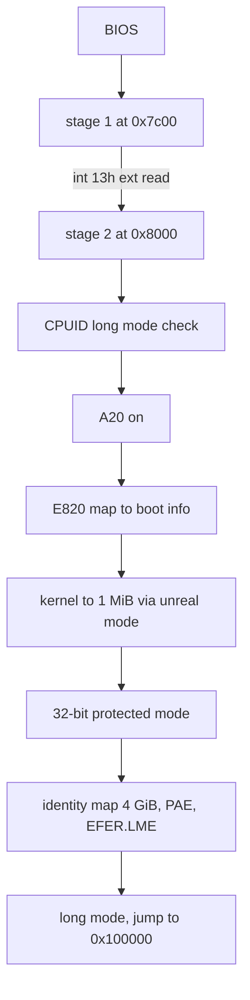
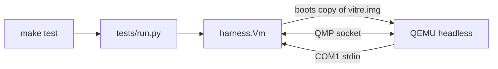

# Architecture

## Disk image

- LBA 0: stage 1 (MBR)
- LBA 1 to 32: stage 2
- LBA 64 onward: kernel

## Physical memory

- 0x5000: boot info (E820 count, entries at 0x5100)
- 0x7c00: stage 1, real-mode stack below it
- 0x8000: stage 2
- 0x20000: kernel load bounce buffer (32 KiB)
- 0x70000: page tables (PML4, PDPT, 4 page directories)
- 0x90000: initial kernel stack top
- 0x100000: kernel image

## Boot flow

## Test flow

