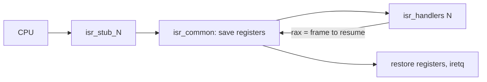
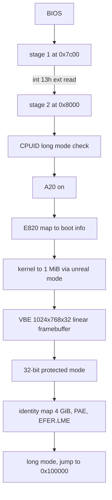
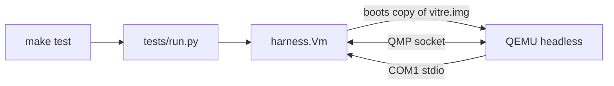
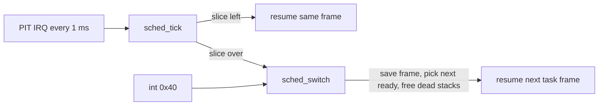
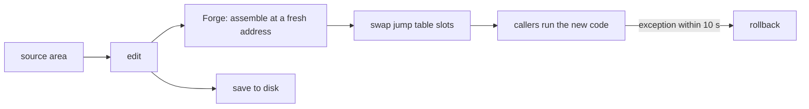
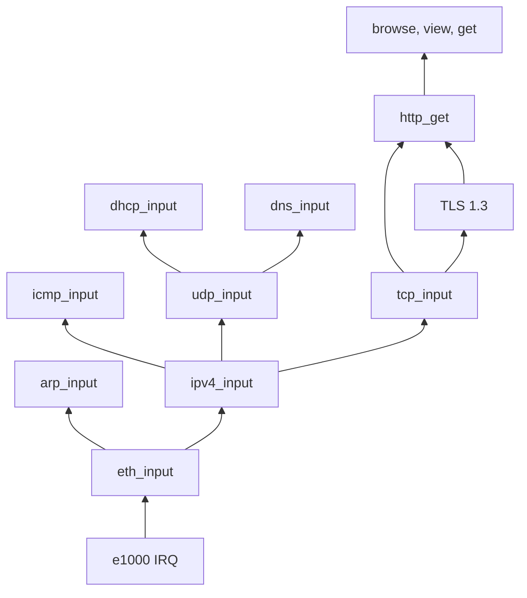

# Architecture

## What is inside

- Boot: a 512-byte MBR, then a stage 2 that reads the E820 map, sets a 1024x768 VBE mode and enters long mode.
- Kernel: interrupts, PIT timer, a bitmap page allocator, a first-fit heap and a preemptive round-robin scheduler.
- Drivers: serial, PS/2 keyboard (AZERTY and QWERTY) and mouse, VBE framebuffer, RTC, ATA PIO, PCI and an Intel e1000 network card.
- Network: Ethernet, ARP, IPv4, ICMP, UDP, DHCP, DNS, TCP and HTTP with redirects.
- Crypto: SHA-256, HMAC, HKDF, ChaCha20-Poly1305, X25519, P-256 ECDSA and X.509 parsing, behind a TLS 1.3 client.
- Apps: the desktop, a shell, a disassembler, the Glass views, the editor and a browser with headings, links, scrolling and history.

## Repo layout

- `boot`: stage 1 and stage 2
- `kernel`: memory, interrupts, scheduler, symbols
- `drivers`: serial, timer, keyboard, mouse, framebuffer, disk, PCI, e1000
- `net`: the network stack, TLS and X.509
- `lib`: strings and crypto primitives
- `forge`: the assembler, the editor and the patcher
- `glass`: the font, console, pointer, disassembler, debugger views and pixel provenance
- `apps`: the desktop, the shell, the browser and the crypto command
- `files`: the user files put on the disk at build time
- `tests`: the Python harness that drives QEMU

## Disk image

- LBA 0: stage 1 (MBR)
- LBA 1 to 32: stage 2
- LBA 64 onward: kernel

## Physical memory

- 0x5000: boot info (E820 count, framebuffer address, pitch, size and depth, E820 entries at 0x5100)
- 0x6000: VBE controller and mode info buffers (stage 2 only)
- 0x7c00: stage 1, real-mode stack below it
- 0x8000: stage 2
- 0x20000: kernel load bounce buffer (32 KiB)
- 0x70000: page tables (PML4, PDPT, 4 page directories)
- 0x90000: initial kernel stack top
- 0x100000: kernel image, then its .bss (cleared at entry)

## Interrupts

Every vector has a stub that pushes an error code (a zero when the CPU pushes none) and the vector number, then jumps to `isr_common`. `isr_common` saves all general registers and calls the handler registered for the vector with `rdi` = frame. The handler returns in `rax` the frame to resume, so a handler can switch to another task by returning that task's saved frame.

Frame layout, from the lowest address: r15, r14, r13, r12, r11, r10, r9, r8, rbp, rdi, rsi, rdx, rcx, rbx, rax, vector, error, then the CPU part (rip, cs, rflags, rsp, ss). Offsets are the `INT_FRAME_*` constants in `kernel/idt.asm`.

- Vectors 0 to 31: CPU exceptions. Without a registered handler, `exception_fatal` dumps the frame and halts.
- Vectors 32 to 47: PIC IRQ 0 to 15. IRQ 0 is the PIT at 1000 Hz, counting `timer_ticks`.

## Boot flow

## Test flow

## Screen

- `drivers/fb.asm`: framebuffer primitives (fill, glyph, scroll a rectangle), 32 bpp `0x00RRGGBB`.
- `glass/console.asm`: a console is a struct (origin, size in cells, cursor, colours) drawing on the 8x16 grid. The kernel log owns a full-screen one, and each Glass pane owns one.
- `kputc` writes every byte to COM1 and, once the framebuffer is up, to the kernel console.
- `drivers/keyboard.asm`: IRQ 1 decodes scancodes into key codes in a ring buffer read by `kbd_getc`.

## Memory

- `kernel/pmm.asm`: `page_alloc(n)` / `page_free(addr, n)` over a bitmap of 4 KiB pages built from E820. Physical addresses are usable directly through the identity map.
- `kernel/heap.asm`: `kmalloc(size)` / `kfree(ptr)`, first fit over an address-ordered free list with 16-byte headers. It grows by at least 1 MiB of contiguous pages at a time.

## Tasks

- `kernel/sched.asm`: `task_create(entry, name, arg)`, `task_yield`, `task_exit`, `sched_list`. The boot code becomes task 0 `kernel`.

## Live patching

- `tools/gen.asm` reads every function header at build time. Functions marked `; patchable: yes` get a slot in the jump table, and every caller goes through `call [rel jt_name]`.
- The source of each file holding a patchable function goes into the source area, stored on disk from LBA 2048 and loaded at boot. `edit` changes it in memory and `save` writes it back. User files (`ls`, `cat`, `rm`) live in the same area.
- Forge, the in-kernel assembler, produces the same bytes as NASM for the [dialect](DIALECT.md) patchable modules are written in. `forge` checks that against the running kernel.
- `patch` runs Forge on the module, writes the code into fresh pages and swaps the module's jump table slots under `cli`. Old code is never freed, since a task may still be running it.
- `forge/guard.asm`: a CPU exception inside the new code within 10 s of the patch puts the old slots back and resumes the shell.

## Glass

- `kernel/debug.asm` pauses a task by having the scheduler skip it, its frame kept as saved. `step` sets the trap flag in that frame, and the `#DB` after one instruction pauses it again.
- `kernel/breakpoint.asm` writes `int3` over an instruction and pauses the task that hits it.
- `glass/view.asm` redraws a task's frame, the disassembly around RIP, its stack and memory while it runs, highlighting registers that changed.
- Pixel provenance: every framebuffer draw records, per pixel, the task and up to six return addresses found by walking the stack. `why <x> <y>` prints that chain, and F12 in any app freezes the screen so a click shows it beside the pointer.

## Network

Frames arrive on the e1000 IRQ and go up the stack inside the handler. There is one TCP connection at a time, read in order into a 256 KiB buffer.

## TLS

`net/tls.asm` offers one suite, TLS_CHACHA20_POLY1305_SHA256 with X25519. The primitives live in `lib`, one file each, and `crypto <primitive>` runs any of them on hex input.

- The handshake keys come from the X25519 secret through HKDF. Then the client checks the server's Finished and sends its own.
- The leaf certificate is parsed with `net/x509.asm`. When its key is P-256, the CertificateVerify signature is checked with `lib/p256.asm` and a bad one fails the handshake.
- A page counts as verified when the CertificateVerify signature holds, the certificate names the host, and the chain ends at a key added with `trust`.
